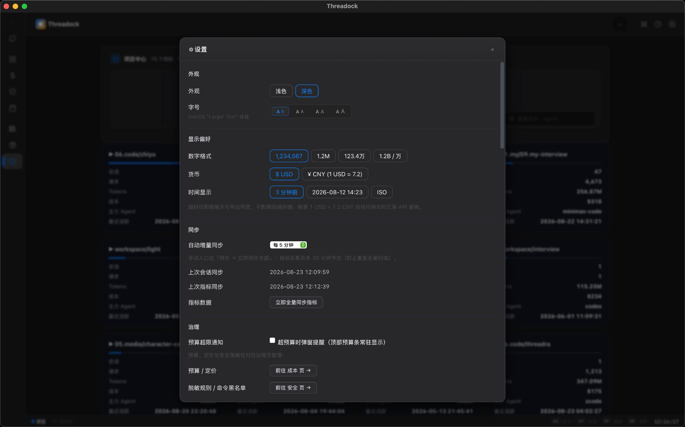

<div align="center">


# Threadock

**One local archive. Every AI coding agent. Fully searchable, governable, and yours.**

A local-first desktop app that unifies conversations, tool calls, commands, diffs, and artifacts from
ZCode · Claude Code · Cursor · MiniMax Code · Codex · DeepSeek Harness — normalizes them into a single searchable corpus,
and continuously governs usage, cost, and security.

[English](README.md) · [简体中文](README.zh-CN.md) · [日本語](README.ja.md) · [한국어](README.ko.md) · [Français](README.fr.md) · [Italiano](README.it.md) · [Español](README.es.md) · [Русский](README.ru.md)


[](https://github.com/SunArthurX/threadock/actions/workflows/ci.yml)
[](https://github.com/SunArthurX/threadock/releases)
[](LICENSE-MIT)
[](#installation)
[](https://www.rust-lang.org)
[](https://tauri.app)
[](docs/privacy.md)

[**Install**](#installation) · [**Features**](#features) · [**Screenshots**](#screenshots) · [**Usage**](#usage) · [**Architecture**](#architecture) · [**Docs**](docs/user-guide.md) · [**Privacy**](docs/privacy.md) · [**Changelog**](CHANGELOG.md)

</div>

---

## Why Threadock

You probably use more than one AI coding agent. ZCode here, Claude Code there, Cursor for editing,
Codex for shell work, MiniMax for the long-running jobs. Each one keeps its own history in its own
format, its own database, its own rules.

Threadock reads those histories **read-only**, normalizes them into a single canonical model, and
gives you:

- **One search box** that hits all of them — with a query language (`provider:`, `workspace:`,
  `type:`, `after:`, `before:`, `file:`, `model:`) and Chinese-friendly tokenization.
- **A knowledge layer** that extracts decisions, TODOs, errors, commands, and files from every
  session — using a fast rule engine by default and an optional LLM engine (OpenAI-compatible
  endpoints, local or cloud) for richer insight.
- **Governance** that tracks token spend per project, surfaces cost trends and cache-hit ratios,
  flags risky commands and leaked secrets, and runs scheduled retention/GC.
- **A desktop client that stays out of your way** — local-first, no account, no telemetry,
  AES-encrypted backups you control.

## Screenshots

All screenshots are captured from **v1.3.0** running against a real corpus of
**48,282 requests · 6.48B tokens · $4,553 spend across 5 agents and 1,184 conversations**.
Light and dark themes are supported; the dark theme is shown.

<table>
  <tr>
    <td></td>
    <td></td>
  </tr>
  <tr>
    <td></td>
    <td></td>
  </tr>
  <tr>
    <td></td>
    <td></td>
  </tr>
  <tr>
    <td></td>
    <td></td>
  </tr>
</table>

> See [docs/optimization-rounds/REPORT.md](docs/optimization-rounds/REPORT.md) for the
> 13-round UI/UX pass that produced the current layout family.

## Installation

[](https://github.com/SunArthurX/threadock/releases/latest)

Grab the right file for your platform from the
[Releases page](https://github.com/SunArthurX/threadock/releases), then verify it against the
published `SHA256SUMS`.

| Platform | Formats |
|---|---|
| macOS (Apple Silicon · Intel) | `.dmg` |
| Windows 10 / 11 | `.msi` · NSIS `.exe` |
| Linux | `.AppImage` · `.deb` |
| CLI binaries | `x86_64` / `aarch64` × macOS · Windows · Linux |

> Installers are **unsigned** for now (cert in progress). macOS: right-click → Open
> (or `xattr -dr com.apple.quarantine <app>`). Windows: *More info* → *Run anyway*. Always
> verify SHA256SUMS.

Prefer building yourself? Jump to [Development → Build from source](#build-from-source).

## Features

### Session hub

| | |
|---|---|
| 🔌 **8 read-only adapters** | ZCode · Claude Code · Cursor · MiniMax Code · Codex · DeepSeek Harness · Markdown · JSONL — process-isolated, crash-safe |
| 🗄️ **SQLite V16 + WAL** | 25+ tables, FTS5 fallback, automatic schema migration on startup |
| 🔍 **Dual search engines** | Tantivy (N-gram Chinese + jieba) primary, FTS5 fallback, query syntax, time-ordered hits |
| 🧬 **Canonical normalization** | Unified 6-source × 19-event-type domain model, BLAKE3-hashed, idempotent, completeness-scored |
| 📦 **Content-addressed raw store** | Every original payload preserved verbatim for re-extraction and audit |
| 🏷️ **Workspace auto-merge** | 7-level priority + confidence, with manual override UI |
| ⭐ **Favorites, tags, archive, soft + hard delete** | With cascade cleanup across search index and raw store |
| 🔁 **Incremental sync** | `import_state` freshness tracking, 10-minute auto-sync, resync after reset, source-side title renames picked up on next sync (your own renames always win) |
| 💡 **Knowledge extraction** | Rule engine by default, LLM engine opt-in (OpenAI / DeepSeek / GLM / Ollama / LM Studio / llama.cpp), schema-versioned, with run history |
| 🔐 **Encrypted backup / restore** | XChaCha20-Poly1305 + Argon2id, key never leaves disk |
| 🧪 **Similar-session recommendations** | Bounded candidate set, useful for rediscovering past context |
| 🧠 **Saved searches** | Cross-session persistence with one-shot re-execute |
| ⇄ **Handoff — continue in any agent** | Write archived sessions (dialog + context preamble with the execution timeline) back into Claude Code / Codex / ZCode / MiniMax Code / Cursor native session stores as brand-new resumable sessions; additive-only, dry-run preview, one click for all |

### CodeAgentOps governance

A second surface for teams and heavy users: usage, cost, security, automation.

- **Usage + cost capture** at request granularity across four agents
- **Dashboard** — cost, cache hit rate, latency P50/P95 trends
- **Security audit** — secret patterns, dangerous commands, HTML reports
- **Policy + budget + pricing** with overrun alerts and month-end projection
- **Asset inventory** — skills / plugins across agents
- **Project cost attribution** with cache-hit analysis
- **Anomaly detection** — error spikes, retry storms, context-overflow events
- **Agent health score** (0–100, stability-weighted)
- **Token waste detection** with cross-agent comparison
- **Weekly report** (HTML, auto-generated)
- **Data lifecycle** — storage dashboard, orphan-blob GC, retention policy, index rebuild
- **Governance audit trail** — every sensitive action logged

### Desktop GUI (7 views)

`Overview` · `Conversations` (timeline + bulk ops) · `Knowledge` (cross-session + dual engine) ·
`Activity` (GitHub-style heatmap + conversation gantt) · `Projects` · `Ops` (cost · assets ·
security · automation) · `Settings`.

- Apple-style light / dark themes, 4 font-size presets (macOS *Larger Text*)
- English / 简体中文 interface (930+ strings, Settings → Appearance → Language)
- Command palette, onboarding tour, first-launch changelog
- Per-conversation private notes, sticky ⌘1–⌘8 sidebar, in-app bottom terminal dock (⌘J)
- Search history dropdown with per-entry delete, conversation gantt chart, conversation list
  horizontal scroll, in-message native image preview
- Same-title conversation collapse (batch runs fold into one `×N` row), search left-panel
  context menu (favorite / archive / pin / tag / delete)

## Usage

`ch` binaries come from a [release](#installation) or a local build (`./target/release/ch`).

### CLI tour

```bash
CH=./target/release/ch

# Import (auto-detects format)
$CH --db ./hub.db import docs/tauri-android.md --workspace my-app

# From real IDE data (read-only)
$CH --db ./hub.db import-from claude-code list
$CH --db ./hub.db import-from zcode <session-id>

# Search with query syntax
$CH --db ./hub.db search 后台任务
$CH --db ./hub.db search-tantivy WorkManager
$CH --db ./hub.db search 'provider:codex 错误处理'
$CH --db ./hub.db search 'workspace:my-app after:2026-01-01 status:favorite tauri'

# Knowledge extraction
$CH --db ./hub.db knowledge <id>            # extract + show
$CH --db ./hub.db knowledge <id> --save     # extract + persist (versioned)
$CH --db ./hub.db knowledge <id> --show     # show stored
$CH --db ./hub.db similar <id>              # similar sessions

# Governance
$CH --db ./hub.db export markdown <id> out.md
$CH --db ./hub.db redaction-rule add my-key 'sk-foo-[0-9]+'
CH_BACKUP_PASSWORD="..." $CH --db ./hub.db backup hub.chbak

# Handoff: write sessions (with context) into another agent's native store, then resume there
$CH --db ./hub.db handoff claude-code --all --dry-run        # preview destinations
$CH --db ./hub.db handoff codex --ids <id1>,<id2> --cwd ~/proj
$CH --db ./hub.db handoff all --all                          # one click, all five agents

# Daemon (JSON-RPC over stdio, 15 methods)
$CH --db ./data daemon
```

### Daemon JSON-RPC

```bash
echo '{"jsonrpc":"2.0","id":1,"method":"system.getInfo","params":{}}' | $CH daemon
echo '{"jsonrpc":"2.0","id":2,"method":"search.query","params":{"query":"tauri","engine":"tantivy"}}' | $CH daemon
```

Methods: `system.getInfo` · `workspace.list` · `conversation.list` · `conversation.get` ·
`conversation.delete` · `conversation.restore` · `conversation.similar` · `conversation.handoff` ·
`message.list` · `event.list` · `search.query` · `knowledge.extract` · `knowledge.save` ·
`knowledge.get` · `provider.sync`. See [docs/api.md](docs/api.md) for the full schema.

## Architecture

<p align="center">
  
</p>

Three layers, one invariant: **third-party data is read-only** — the single deliberate exception is
[Handoff](#features), which only ever *appends* brand-new sessions to an agent's store and never
touches existing ones.

- **Adapters** — eight adapters (markdown, jsonl, claude-code, zcode, cursor, minimax, codex, deepseek-harness) run as
  isolated child processes over stdio JSON-RPC. Crashes don't take down the host; timeouts
  don't hang the UI.
- **Core (`DaemonState`)** — the only writer. BLAKE3 content addressing, zstd compression,
  idempotency, completeness scoring, an audit trail. Twenty-five-plus SQLite tables (V16) plus a
  Tantivy index with N-gram Chinese tokenization (or jieba, opt-in).
- **Frontends** — a Tauri 2 desktop app (React + TS, 101 commands, 7 views), a `ch` CLI, a
  long-lived JSON-RPC daemon (15 methods), and a documented public API for external clients.

## Repository layout

```
threadock/
├── crates/
│   ├── domain/              canonical model (6 sources × 19 event types)
│   ├── storage/             SQLite V16 + Migration + FTS5 + governance tables
│   ├── raw-store/           content-addressed payloads (BLAKE3 + zstd)
│   ├── search/              Tantivy (N-gram Chinese + jieba opt-in)
│   ├── identity-resolver/   workspace auto-merge (7 priority levels)
│   ├── normalization/       BLAKE3 hash + idempotency + completeness
│   ├── export/              Markdown / JSON + redaction
│   ├── handoff/             write sessions back into agent-native stores (the only write path)
│   ├── backup/              XChaCha20-Poly1305 + Argon2id
│   ├── knowledge/           rule + LLM dual engine (versioned)
│   ├── llm/                 LLM client + AEAD secret vault
│   ├── adapter-sdk/         Adapter trait + stdio JSON-RPC protocol
│   ├── adapter-host/        process isolation (spawn / timeout / crash)
│   ├── adapter-markdown/    Markdown adapter (separate binary)
│   ├── adapter-jsonl/       JSONL adapter
│   ├── adapter-claude-code/ Claude Code adapter
│   ├── adapter-zcode/       ZCode adapter (SQLite read)
│   ├── adapter-cursor/      Cursor adapter (state.vscdb)
│   ├── adapter-minimax/     MiniMax Code adapter
│   ├── adapter-codex/       Codex adapter
│   ├── adapter-deepseek-harness/ DeepSeek Harness (dsh) adapter
│   ├── ops-metrics/         usage / cost / health metrics
│   ├── audit/               security audit (secrets + dangerous commands)
│   ├── benchmarks/          perf, search latency, cold start
│   ├── daemon/              long-running service (JSON-RPC over stdio)
│   └── cli/                 `ch` command-line
├── apps/desktop/            Tauri 2 desktop (React + TS)
│   ├── src/                 7 views · 101 commands · 90+ SVG icons
│   └── src-tauri/           Rust backend
├── docs/                    plans, user guide, privacy, API, benchmarks
├── fixtures/                anonymized golden fixtures + adapter tests
└── .github/workflows/       CI (3 OS × lint × test) · CodeQL · release
```

## Development

### Build from source

```bash
git clone https://github.com/SunArthurX/threadock.git
cd threadock

# Desktop app (dev mode)
cd apps/desktop
npm install
npx tauri dev          # dev mode shows the real app icon in the Dock

# CLI + Daemon + Markdown adapter
cargo build --release -p ch-cli -p ch-daemon -p ch-adapter-markdown

# Desktop release build
cd apps/desktop && npm install && npm run build
cd src-tauri && cargo build --release
```

Releases: pushing a `v*` tag triggers the [release pipeline](.github/workflows/release.yml),
which builds the installers, CLI binaries, and SHA256SUMS listed under [Installation](#installation).

### Pre-commit / pre-push

```bash
scripts/precheck.sh --install-hooks    # one-time: pre-commit=lint, pre-push=test
scripts/precheck.sh                    # manual: fmt×2 + clippy×2 + tsc + eslint
scripts/precheck.sh test               # lint + all tests + build (mirrors CI)
scripts/precheck.sh all                # + cargo audit + MSRV 1.88 check
```

The script mirrors `.github/workflows/ci.yml` command-for-command. `clippy` runs with the
**same flags CI does** (`-W clippy::pedantic -D warnings`) — running bare `cargo clippy`
locally will miss pedantic violations. Emergency escape: `git commit --no-verify`.

### Testing

```bash
cargo test --workspace                                          # Rust core
cargo test --manifest-path apps/desktop/src-tauri/Cargo.toml   # Tauri commands
cd apps/desktop && npm test                                     # React + TS
cargo clippy --workspace --all-targets                          # pedantic-level clean
cargo test -p ch-search --features jieba                        # jieba tokenization
cargo test --release -p ch-benchmarks --test perf -- --ignored --nocapture
cargo test --release -p ch-benchmarks --test perf large_scale -- --ignored --nocapture
```

| | |
|---|---|
| **Automated tests** | Rust 608 + TS 431, enforced by [CI](https://github.com/SunArthurX/threadock/actions/workflows/ci.yml) |
| **Gate 1** | 100k sessions / 500k messages FTS5 search P95 = **50.9 ms** (target 300 ms) — see [docs/benchmark-report-v1.0.0.md](docs/benchmark-report-v1.0.0.md) |
| **Workspace merge accuracy** | 11 hand-labeled samples = 100% (zero erroneous auto-merge) |
| **ESLint** | 0 errors / 0 warnings |
| **Supply-chain advisories** | 2 fixed, 1 upstream-blocked (RUSTSEC-2026-0253, awaiting tantivy bump; CI tolerates) |

## Key design decisions

| Decision | Status | Why |
|---|---|---|
| Local-first | ✅ | Your conversation history stays on your machine. No account, no telemetry, no upload. |
| SQLite WAL | ✅ (V16) | Single-file durability, easy backups, predictable under load. |
| Tauri 2 desktop | ✅ | Native window + WebView; one Rust binary embedding the daemon. |
| Rust core | ✅ (MSRV 1.88) | Memory safety + zero-cost FFI; pedantic clippy as a quality bar. |
| Tantivy search | ✅ (N-gram + jieba) | N-gram is the default (no external deps); jieba opt-in for better Chinese recall. |
| Adapter process isolation | ✅ | IDE adapters are read-only and run as separate processes — a buggy adapter can't take down the host. |
| Raw + Normalized dual storage | ✅ | Original payloads preserved (BLAKE3-keyed) for re-extraction; normalized form for search. |
| Third-party data is read-only | ✅ | Hard rule. We never write back to `~/.claude`, `state.vscdb`, etc. |

Full rationale: [docs/conversation-hub-execution-plan.md §1.3](docs/conversation-hub-execution-plan.md).

## Documentation

- [User guide](docs/user-guide.md) — installation, seven views, sync, search, knowledge, backup
- [Privacy statement](docs/privacy.md) — what we read, what we store, what we *don't* do
- [API reference](docs/api.md) — auto-generated Tauri command surface + Daemon JSON-RPC methods
- [Performance benchmark](docs/benchmark-report-v1.0.0.md) — Gate 1 large-scale results
- [Overall plan](docs/ai-ide-conversation-hub-enterprise-plan.md) · [Execution plan](docs/conversation-hub-execution-plan.md) · [Governance plan](docs/codeagent-ops-plan.md)
- [UI optimization report](docs/optimization-rounds/REPORT.md) — 13 rounds × 30+ changes each
- [Changelog](CHANGELOG.md)

## Roadmap

- [ ] OpenCode adapter (7th IDE source)
- [ ] Daemon UDS / Named Pipe IPC + local auth token (today: stdio only)
- [ ] Adapter host resource quotas (memory / CPU / file whitelist / network denial)
- [ ] Tauri Updater auto-update + installer code-signing / notarization
- [ ] Android browse-only client (Phase 4 PoC)
- [ ] Enterprise: SSO / RBAC / KMS / encrypted sync (Phase 5)

## Contributing

Issues and PRs are welcome. Before opening one:

1. Read [docs/conversation-hub-execution-plan.md](docs/conversation-hub-execution-plan.md) —
   the "non-negotiable decisions" section explains why things are the way they are.
2. Run `scripts/precheck.sh test` — same commands CI runs.
3. If your change touches a public API (Tauri command, CLI subcommand, JSON-RPC method),
   update the relevant doc under `docs/`.

For larger changes, file an issue first to discuss the approach. The maintainer is the
project's only full-time contributor; please be patient on review.

## License

Dual-licensed under either of:

- [MIT](LICENSE-MIT)
- [Apache 2.0](LICENSE-APACHE)

at your option.

## Acknowledgments

- [Tantivy](https://github.com/quickwit-oss/tantivy) for the search engine
- [Tauri](https://tauri.app) for the desktop shell
- [SQLite](https://sqlite.org) for the storage layer
- [React](https://react.dev), [Vite](https://vitejs.dev), [Vitest](https://vitest.dev) for the frontend
- [xterm.js](https://xtermjs.org) for the in-app terminal
- The teams behind ZCode, Claude Code, Cursor, MiniMax Code, Codex, and DeepSeek Harness for the underlying products

---

<sub align="center">Built and maintained by <a href="https://github.com/SunArthurX">SunArthurX</a> · 2026</sub>
