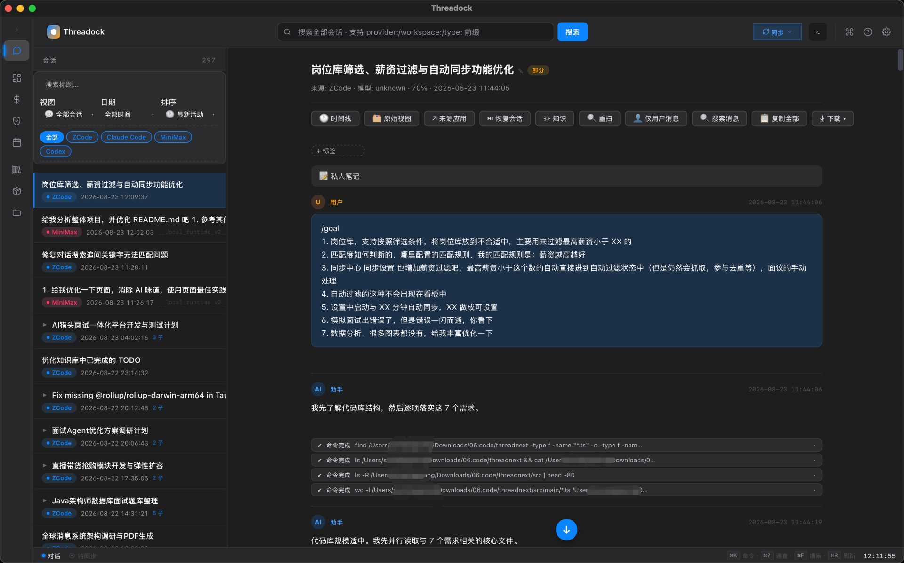
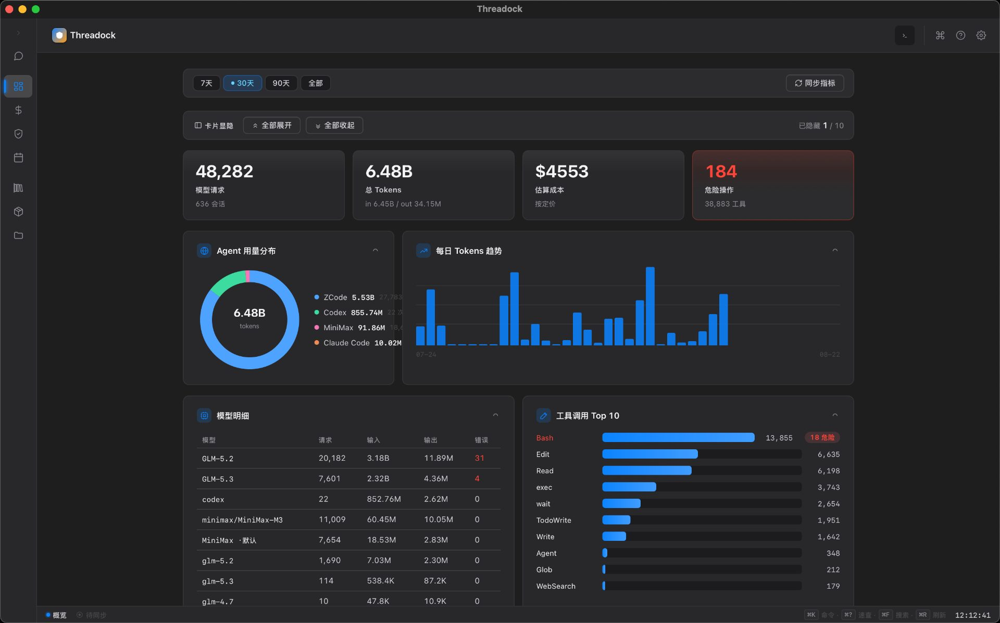
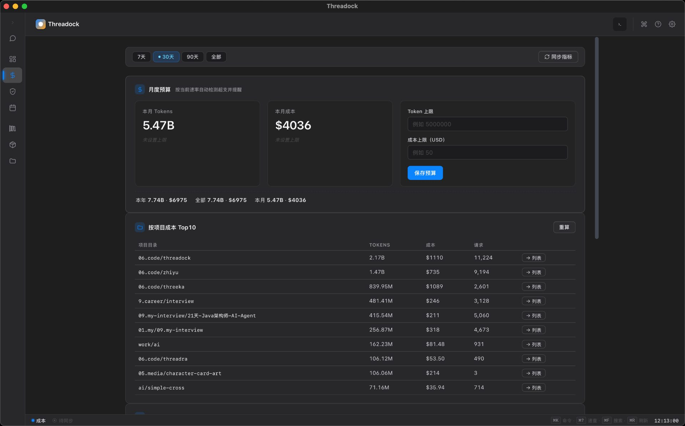
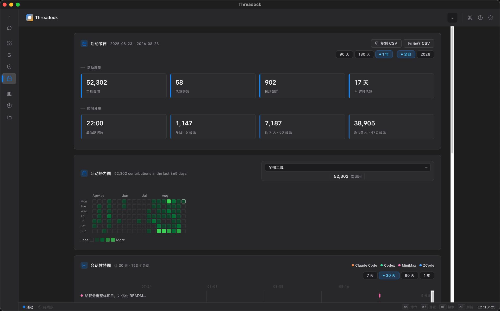
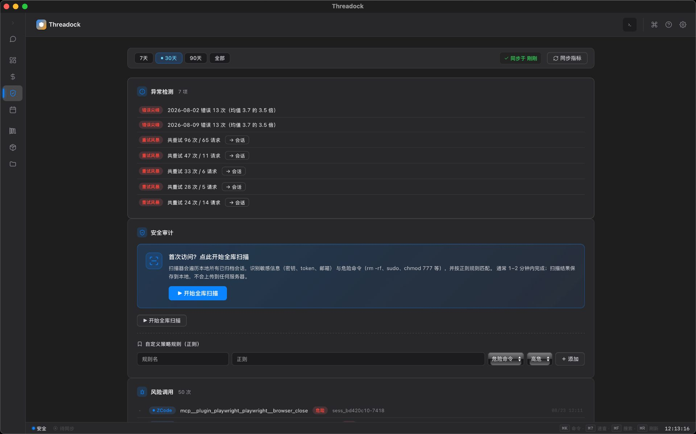
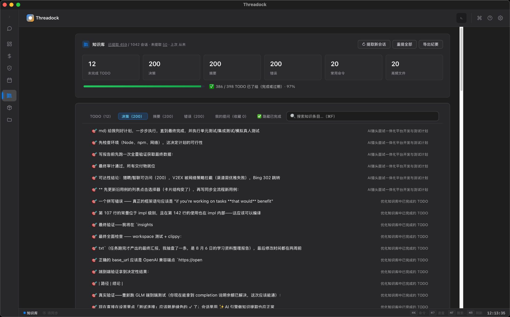
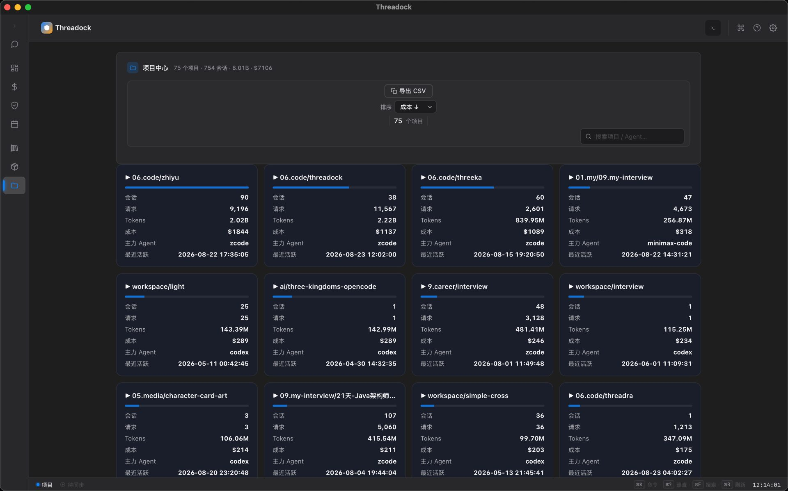
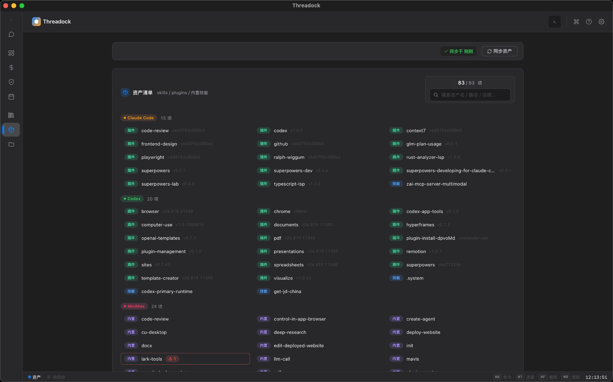
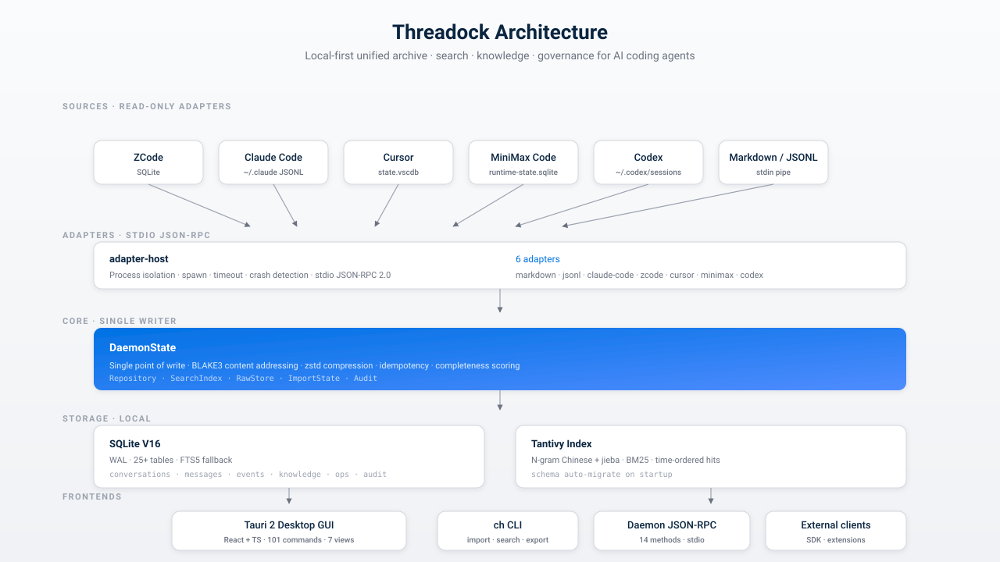

<div align="center">


# Threadock

**Один локальный архив. Все ваши ИИ-агенты для кодинга. Полнотекстовый поиск, управление — и всё это ваше.**

Local-first десктоп-приложение, которое собирает диалоги, вызовы инструментов, команды, диффы и
артефакты из ZCode · Claude Code · Cursor · MiniMax Code · Codex · DeepSeek Harness — нормализует их
в единый поископригодный корпус и непрерывно управляет потреблением, стоимостью и безопасностью.

[English](README.md) · [简体中文](README.zh-CN.md) · [日本語](README.ja.md) · [한국어](README.ko.md) · [Français](README.fr.md) · [Italiano](README.it.md) · [Español](README.es.md) · [Русский](README.ru.md)

</div>

<div align="center">

[](CHANGELOG.md)
[](LICENSE-MIT)
[](https://www.rust-lang.org)
[](https://tauri.app)
[](https://react.dev)
[](#тесты)
[](#установщики)
[](docs/privacy.md)

</div>

<div align="center">

[**Быстрый старт**](#быстрый-старт) · [**Возможности**](#возможности) · [**Архитектура**](#архитектура) · [Руководство пользователя](docs/user-guide.md) · [Приватность](docs/privacy.md) · [История изменений](CHANGELOG.md)

</div>

> 🌐 Русская версия — перевод сообщества. Актуальный первоисточник — [English](README.md) версия.

---

## Почему Threadock

Скорее всего, вы пользуетесь не одним ИИ-агентом для кодинга. Где-то ZCode, где-то Claude Code,
Cursor для редактирования, Codex для работы в shell, MiniMax для долгих задач. Каждый хранит свою
историю в собственном формате, собственной базе и по собственным правилам.

Threadock читает эти истории **только для чтения**, нормализует их в единую каноническую модель и
даёт вам:

- **Одну строку поиска** по всем агентам — с языком запросов (`provider:`, `workspace:`, `type:`,
  `after:`, `before:`, `file:`, `model:`) и токенизацией, дружественной к китайскому
  (и к японскому/корейскому)
- **Слой знаний**, извлекающий из каждой сессии решения, TODO, ошибки, команды и файлы — быстрый
  движок на правилах по умолчанию и опциональный LLM-движок (OpenAI-совместимые эндпоинты, локальные
  или облачные) для более глубокой аналитики
- **Управление (governance)**: расходы токенов по проектам, тренды стоимости и hit-rate кэша, флаги
  рискованных команд и утёкших секретов, плановая ретеншн/очистка
- **Десктоп-клиент, который не мешает** — local-first, без аккаунта, без телеметрии, AES-шифрованные
  бэкапы под вашим контролем

## Скриншоты

Все скриншоты ниже сняты с **v1.3.0**, работающей на реальном корпусе из
**48 282 запросов · 6,48 млрд токенов · $4 553 расходов, 5 агентов и 1 184 диалога**.
Поддерживаются светлая и тёмная темы; показана тёмная.

<table>
  <tr>
    <td colspan="2"></td>
  </tr>
  <tr>
    <td></td>
    <td></td>
  </tr>
  <tr>
    <td></td>
    <td></td>
  </tr>
  <tr>
    <td></td>
    <td></td>
  </tr>
  <tr>
    <td colspan="2"></td>
  </tr>
</table>

> 13 раундов UI/UX-полировки, породивших текущее семейство макетов, описаны в
> [docs/optimization-rounds/REPORT.md](docs/optimization-rounds/REPORT.md).

## Архитектура

<p align="center">
  
</p>

Три слоя, один инвариант: **сторонние данные — только для чтения**.

- **Адаптеры** — восемь адаптеров (markdown, jsonl, claude-code, zcode, cursor, minimax, codex,
  deepseek-harness) работают как изолированные дочерние процессы через stdio JSON-RPC. Крэш не валит
  хост; таймаут не подвешивает UI
- **Ядро (`DaemonState`)** — единственный писатель. Контентная адресация BLAKE3, сжатие zstd,
  идемпотентность, оценка полноты, аудит-след. Более двадцати пяти таблиц SQLite (V16) плюс индекс
  Tantivy с N-gram-токенизацией для китайского (или jieba по желанию)
- **Фронтенды** — десктоп-приложение Tauri 2 (React + TS, 101 команда, 7 представлений), CLI `ch`,
  постоянно живущий JSON-RPC демон (14 методов) и документированный публичный API для внешних клиентов

## Возможности

### Хаб сессий

| | |
|---|---|
| 🔌 **8 адаптеров «только чтение»** | ZCode · Claude Code · Cursor · MiniMax Code · Codex · DeepSeek Harness · Markdown · JSONL — изоляция процессами, устойчивость к крэшам |
| 🗄️ **SQLite V16 + WAL** | 25+ таблиц, FTS5-фолбэк, автоматическая миграция схемы при старте |
| 🔍 **Два поисковых движка** | Tantivy (N-gram для китайского + jieba) основной, FTS5 запасной, синтаксис запросов, хиты в хронологическом порядке |
| 🧬 **Каноническая нормализация** | Единая доменная модель «6 источников × 19 типов событий», BLAKE3-хэш, идемпотентность, оценка полноты |
| 📦 **Raw store с контентной адресацией** | Каждый оригинальный payload сохраняется дословно — для переизвлечения и аудита |
| 🏷️ **Автосклейка рабочих пространств** | 7 уровней приоритета + уверенность, UI ручного переопределения |
| ⭐ **Избранное, теги, архив, мягкое + жёсткое удаление** | С каскадной очисткой поискового индекса и raw store |
| 🔁 **Инкрементальная синхронизация** | отслеживание свежести `import_state`, автосинк каждые 10 минут, ресинк после сброса, переименования на стороне источника подхватываются при следующем синке (ваши переименования всегда главнее) |
| 💡 **Извлечение знаний** | По умолчанию движок на правилах, опционально LLM-движок (OpenAI / DeepSeek / GLM / Ollama / LM Studio / llama.cpp), версионируемая схема, история запусков |
| 🔐 **Шифрованные бэкап / восстановление** | XChaCha20-Poly1305 + Argon2id, ключ никогда не покидает диск |
| 🧪 **Рекомендации похожих сессий** | Ограниченный набор кандидатов — удобно возвращаться к прошлому контексту |
| 🧠 **Сохранённые запросы** | Межсессионная персистентность, повторное выполнение в один клик |

### Governance CodeAgentOps

Вторая поверхность для команд и интенсивных пользователей: потребление, стоимость, безопасность, автоматизация.

- **Сбор потребления и стоимости** с точностью до запроса по четырём агентам
- **Дашборд** — стоимость, hit-rate кэша, тренды латентности P50/P95
- **Аудит безопасности** — паттерны секретов, опасные команды, HTML-отчёты
- **Политики + бюджеты + тарифы** с алертами перерасхода и прогнозом на конец месяца
- **Инвентаризация активов** — skills / plugins по всем агентам
- **Атрибуция стоимости по проектам** с анализом hit-rate кэша
- **Детекция аномалий** — всплески ошибок, шторма ретраев, переполнения контекста
- **Health-score агента** (0–100, с весом на стабильность)
- **Детекция потерь токенов** со сравнением между агентами
- **Недельный отчёт** (HTML, генерируется автоматически)
- **Жизненный цикл данных** — дашборд хранилища, GC сиротских blob'ов, политика ретеншна, перестройка индекса
- **Аудит-след управления** — каждое чувствительное действие логируется

### Десктоп-GUI (7 представлений)

`Обзор` · `Диалоги` (таймлайн + массовые операции) · `Знания` (межсессионность + два движка) ·
`Активность` (heatmap в стиле GitHub + Ганта по диалогам) · `Проекты` · `Ops` (стоимость · активы ·
безопасность · автоматизация) · `Настройки`.

- Светлая / тёмная тема в стиле Apple, 4 размера шрифта (macOS *Larger Text*)
- Интерфейс на английском / упрощённом китайском (930+ строк, Настройки → Внешний вид → Язык)
- Командная палитра, онбординг-тур, changelog при первом запуске
- Приватные заметки к каждому диалогу, закрепление сайдбара ⌘1–⌘8, встроенный терминал-док внизу (⌘J)
- История поиска с удалением по записям, Ганта диалогов, горизонтальный скролл списка, нативный
  просмотр картинок в сообщениях
- Свёртка одноимённых диалогов (пакетные прогоны — в одну строку `×N`), контекстное меню левой
  панели поиска (избранное / архив / закрепить / тег / удалить)

## Быстрый старт

### Десктоп (разработка)

```bash
git clone https://github.com/SunArthurX/threadock.git
cd threadock
cd apps/desktop
npm install
npx tauri dev          # в dev-режиме Dock показывает настоящий значок приложения
```

### Полная сборка

```bash
# CLI + Daemon + Markdown-адаптер
cargo build --release -p ch-cli -p ch-daemon -p ch-adapter-markdown

# Tauri-десктоп
cd apps/desktop && npm install && npm run build
cd src-tauri && cargo build --release
```

### Установщики

Пуш тега `v*` → [релизный пайплайн](.github/workflows/release.yml) собирает и публикует
Tauri-инсталляторы для **macOS** (dmg arm64 + x64), **Windows** (nsis + msi) и **Linux**
(appimage + deb), плюс CLI-бинарники под четыре платформы и SHA256SUMS.

[](https://github.com/SunArthurX/threadock/releases)

> Инсталляторы пока **не подписаны** (сертификат в процессе). macOS: правый клик → Открыть
> (или `xattr -dr com.apple.quarantine <app>`). Windows: *Подробнее* → *Всё равно выполнить*.
> Всегда сверяйте SHA256SUMS.

### Тур по CLI

```bash
CH=./target/release/ch

# Импорт (формат определяется автоматически)
$CH --db ./hub.db import docs/tauri-android.md --workspace my-app

# Из реальных данных IDE (только чтение)
$CH --db ./hub.db import-from claude-code list
$CH --db ./hub.db import-from zcode <session-id>

# Поиск с синтаксисом запросов
$CH --db ./hub.db search 后台任务
$CH --db ./hub.db search-tantivy WorkManager
$CH --db ./hub.db search 'provider:codex обработка ошибок'
$CH --db ./hub.db search 'workspace:my-app after:2026-01-01 status:favorite tauri'

# Извлечение знаний
$CH --db ./hub.db knowledge <id>            # извлечь и показать
$CH --db ./hub.db knowledge <id> --save     # извлечь и сохранить (с версией)
$CH --db ./hub.db knowledge <id> --show     # показать сохранённое
$CH --db ./hub.db similar <id>              # похожие сессии

# Управление / бэкап
$CH --db ./hub.db export markdown <id> out.md
$CH --db ./hub.db redaction-rule add my-key 'sk-foo-[0-9]+'
CH_BACKUP_PASSWORD="..." $CH --db ./hub.db backup hub.chbak

# Демон (JSON-RPC поверх stdio, 14 методов)
$CH --db ./data daemon
```

### Daemon JSON-RPC

```bash
echo '{"jsonrpc":"2.0","id":1,"method":"system.getInfo","params":{}}' | $CH daemon
echo '{"jsonrpc":"2.0","id":2,"method":"search.query","params":{"query":"tauri","engine":"tantivy"}}' | $CH daemon
```

Методы: `system.getInfo` · `workspace.list` · `conversation.list` · `conversation.get` ·
`conversation.delete` · `conversation.restore` · `conversation.similar` · `message.list` ·
`event.list` · `search.query` · `knowledge.extract` · `knowledge.save` · `knowledge.get` ·
`provider.sync`. Полная схема — в [docs/api.md](docs/api.md).

## Структура репозитория

```
threadock/
├── crates/
│   ├── domain/              каноническая модель (6 источников × 19 типов событий)
│   ├── storage/             SQLite V16 + миграции + FTS5 + таблицы governance
│   ├── raw-store/           контентно-адресуемые payload'ы (BLAKE3 + zstd)
│   ├── search/              Tantivy (N-gram + jieba опционально)
│   ├── identity-resolver/   автосклейка рабочих пространств (7 уровней приоритета)
│   ├── normalization/       BLAKE3-хэш + идемпотентность + полнота
│   ├── export/              экспорт Markdown / JSON + редакция
│   ├── backup/              XChaCha20-Poly1305 + Argon2id
│   ├── knowledge/           движки правила + LLM (версионируемые)
│   ├── llm/                 LLM-клиент + AEAD-хранилище секретов
│   ├── adapter-sdk/         трейт Adapter + протокол stdio JSON-RPC
│   ├── adapter-host/        изоляция процессов (spawn / таймаут / крэш)
│   ├── adapter-markdown/    Markdown-адаптер (отдельный бинарник)
│   ├── adapter-jsonl/       JSONL-адаптер
│   ├── adapter-claude-code/ адаптер Claude Code
│   ├── adapter-zcode/       адаптер ZCode (чтение SQLite)
│   ├── adapter-cursor/      адаптер Cursor (state.vscdb)
│   ├── adapter-minimax/     адаптер MiniMax Code
│   ├── adapter-codex/       адаптер Codex
│   ├── adapter-deepseek-harness/ адаптер DeepSeek Harness (dsh)
│   ├── ops-metrics/         метрики потребления / стоимости / здоровья
│   ├── audit/               аудит безопасности (секреты + опасные команды)
│   ├── benchmarks/          производительность, латентность поиска, холодный старт
│   ├── daemon/              постоянный сервис (JSON-RPC поверх stdio)
│   └── cli/                 командная строка `ch`
├── apps/desktop/            десктоп Tauri 2 (React + TS)
│   ├── src/                 7 представлений · 101 команда · 90+ SVG-иконок
│   └── src-tauri/           Rust-бэкенд
├── docs/                    планы, руководство, приватность, API, бенчмарки
├── fixtures/                анонимизированные золотые фикстуры + тесты адаптеров
└── .github/workflows/       CI (3 OS × lint × test) · CodeQL · релизы
```

## Разработка

### Pre-commit / pre-push

```bash
scripts/precheck.sh --install-hooks    # однократно: pre-commit=lint, pre-push=test
scripts/precheck.sh                    # вручную: fmt×2 + clippy×2 + tsc + eslint
scripts/precheck.sh test               # lint + все тесты + сборка (= CI)
scripts/precheck.sh all                # + cargo audit + проверка MSRV 1.88
```

Скрипт команда-в-команду повторяет `.github/workflows/ci.yml`. `clippy` запускается с теми же
флагами, что и в CI (`-W clippy::pedantic -D warnings`) — «голый» локальный `cargo clippy` пропустит
pedantic-нарушения. Аварийный обход: `git commit --no-verify`.

### Тесты

```bash
cargo test --workspace                                          # Rust-ядро
cargo test --manifest-path apps/desktop/src-tauri/Cargo.toml   # команды Tauri
cd apps/desktop && npm test                                     # React + TS
cargo clippy --workspace --all-targets                          # чисто на pedantic-уровне
cargo test -p ch-search --features jieba                        # токенизация jieba
cargo test --release -p ch-benchmarks --test perf -- --ignored --nocapture
cargo test --release -p ch-benchmarks --test perf large_scale -- --ignored --nocapture
```

| | |
|---|---|
| **Gate 1** | FTS5-поиск по 100k сессий / 500k сообщений: P95 = **50,9 мс** (цель 300 мс) — см. [docs/benchmark-report-v1.0.0.md](docs/benchmark-report-v1.0.0.md) |
| **Точность склейки рабочих пространств** | 11 вручную размеченных образцов = 100 % (ноль ошибочных автосклеек) |
| **ESLint** | 0 ошибок / 0 предупреждений |
| **Advisory по цепочке поставок** | 2 исправлено, 1 заблокирован апстримом (RUSTSEC-2026-0253, ждём bump tantivy; CI терпит) |

## Ключевые проектные решения

| Решение | Статус | Почему |
|---|---|---|
| Local-first | ✅ | История диалогов остаётся на вашей машине. Без аккаунта, без телеметрии, без загрузок в облако. |
| SQLite WAL | ✅ (V16) | Надёжность одного файла, простые бэкапы, предсказуемость под нагрузкой. |
| Десктоп Tauri 2 | ✅ | Нативное окно + WebView; один Rust-бинарник со встроенным демоном. |
| Rust-ядро | ✅ (MSRV 1.88) | Безопасность памяти + zero-cost FFI; pedantic clippy как планка качества. |
| Поиск Tantivy | ✅ (N-gram + jieba) | N-gram по умолчанию (ноль внешних зависимостей); jieba опционально для лучшей полноты по китайскому. |
| Процессная изоляция адаптеров | ✅ | IDE-адаптеры только читают и живут отдельными процессами — багованный адаптер не уронит хост. |
| Двойное хранение: raw + нормализованное | ✅ | Оригинальные payload'ы сохраняются (BLAKE3-ключи) для переизвлечения; нормализованная форма — для поиска. |
| Сторонние данные — только чтение | ✅ | Железное правило. Никогда не пишем в `~/.claude`, `state.vscdb` и т. д. |

Полное обоснование: [docs/conversation-hub-execution-plan.md §1.3](docs/conversation-hub-execution-plan.md).

## Документация

- [Руководство пользователя](docs/user-guide.md) — установка, семь представлений, синк, поиск, знания, бэкап
- [Заявление о приватности](docs/privacy.md) — что читаем, что храним и чего **не** делаем
- [Справочник API](docs/api.md) — автогенерируемая поверхность команд Tauri + методы JSON-RPC демона
- [Бенчмарк производительности](docs/benchmark-report-v1.0.0.md) — крупномасштабные результаты Gate 1
- [Общий план](docs/ai-ide-conversation-hub-enterprise-plan.md) · [План исполнения](docs/conversation-hub-execution-plan.md) · [План governance](docs/codeagent-ops-plan.md)
- [Отчёт об оптимизации UI](docs/optimization-rounds/REPORT.md) — 13 раундов × 30+ изменений в каждом
- [История изменений](CHANGELOG.md)

## Дорожная карта

- [ ] Адаптер OpenCode (7-й IDE-источник)
- [ ] UDS / Named Pipe IPC демона + локальный auth-токен (сейчас: только stdio)
- [ ] Ресурсные квоты adapter host (память / CPU / whitelist файлов / запрет сети)
- [ ] Автообновление Tauri Updater + подпись / нотаризация инсталляторов
- [ ] Android-клиент только для просмотра (PoC фазы 4)
- [ ] Enterprise: SSO / RBAC / KMS / шифрованная синхронизация (фаза 5)

## Как внести вклад

Issues и PR приветствуются. Перед открытием:

1. Прочитайте [docs/conversation-hub-execution-plan.md](docs/conversation-hub-execution-plan.md) —
   раздел «непреложные решения» объясняет, почему всё устроено именно так.
2. Запустите `scripts/precheck.sh test` — те же команды, что и в CI.
3. Если изменение затрагивает публичный API (команда Tauri, сабкоманда CLI, метод JSON-RPC) —
   обновите соответствующий документ в `docs/`.

Крупные изменения сначала обсужайте в issue. Мейнтейнер — единственный штатный контрибьютор
проекта; проверка может занять время.

## License

Двойная лицензия на выбор:

- [MIT](LICENSE-MIT)
- [Apache 2.0](LICENSE-APACHE)

## Благодарности

- [Tantivy](https://github.com/quickwit-oss/tantivy) — поисковый движок
- [Tauri](https://tauri.app) — десктоп-оболочка
- [SQLite](https://sqlite.org) — слой хранения
- [React](https://react.dev), [Vite](https://vitejs.dev), [Vitest](https://vitest.dev) — фронтенд
- [xterm.js](https://xtermjs.org) — встроенный терминал
- Команды ZCode, Claude Code, Cursor, MiniMax Code, Codex и DeepSeek Harness

---

<sub align="center">Создано и поддерживается <a href="https://github.com/SunArthurX">SunArthurX</a> · 2026</sub>
